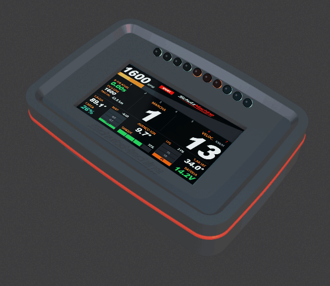
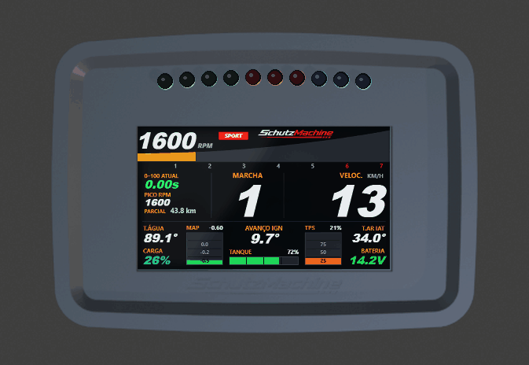
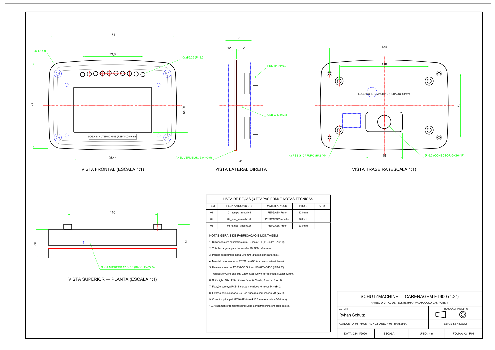
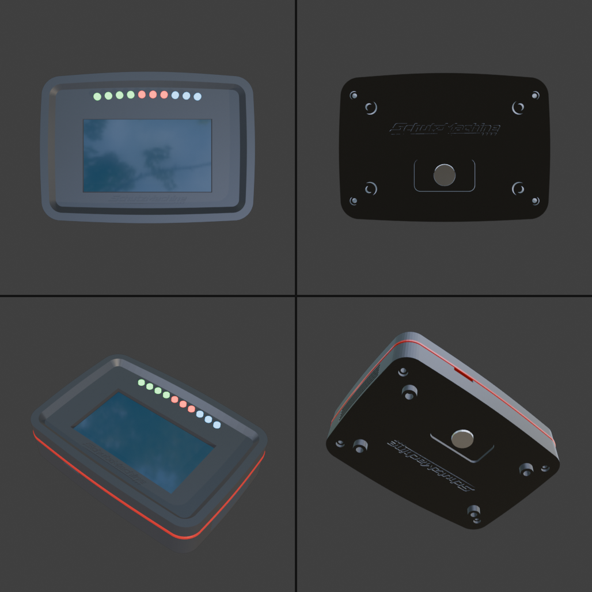
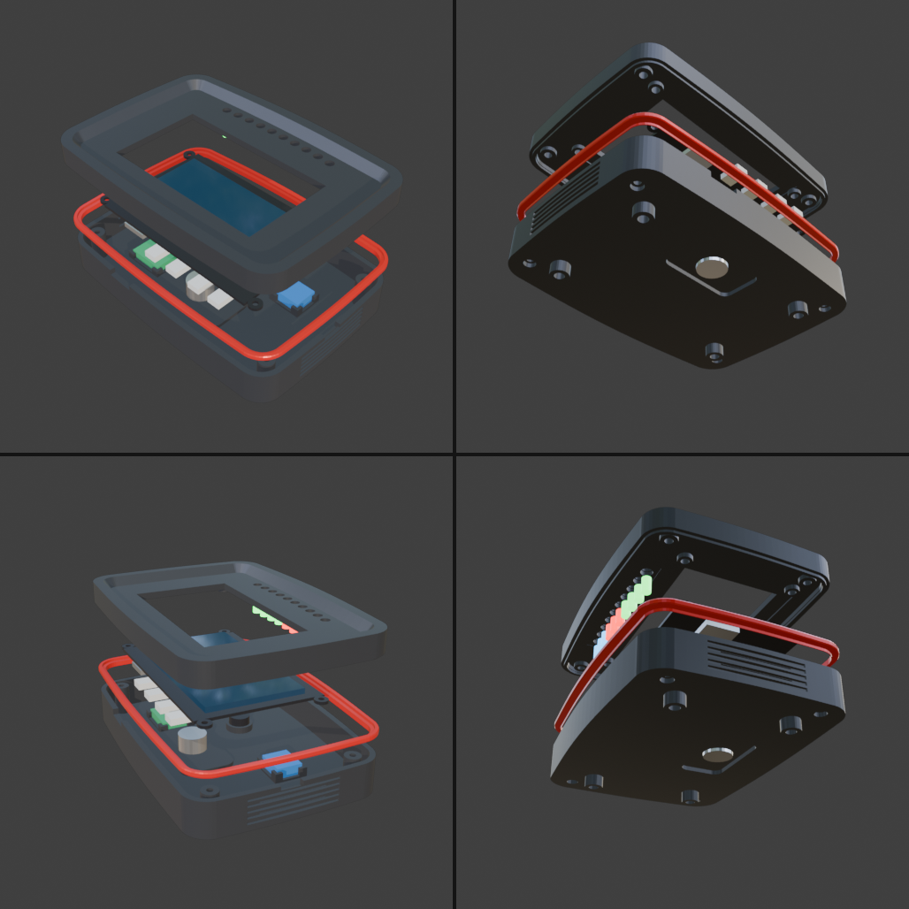
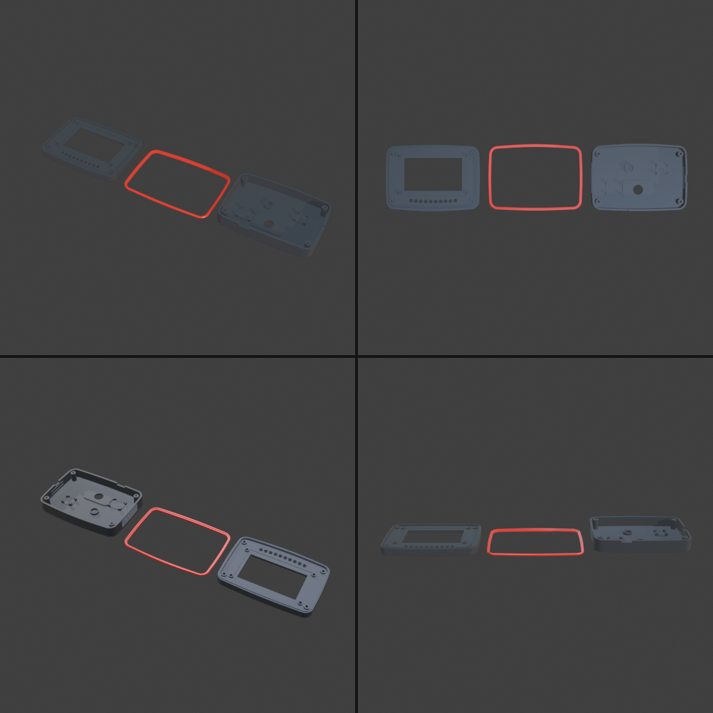
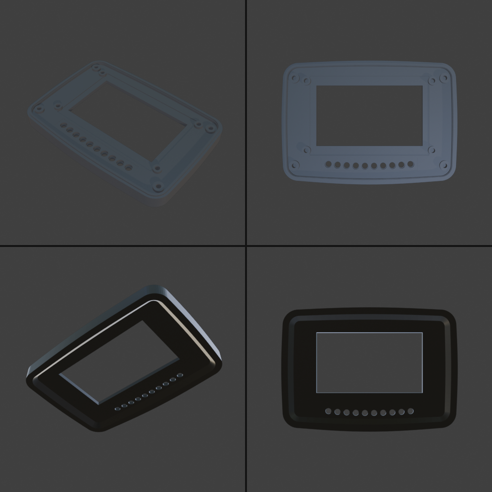
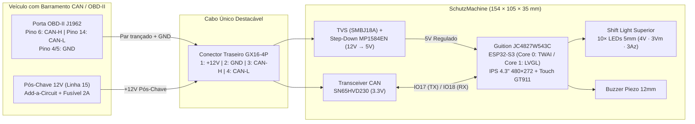
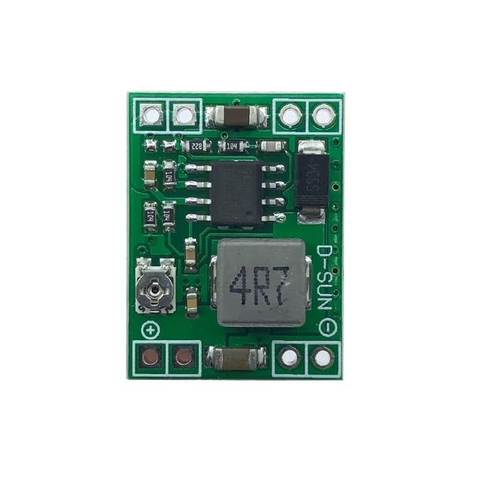

<div align="center">


### Painel Digital de Telemetria Automotiva Stand-Alone — Protocolo CAN / OBD-II
**Hardware aberto embarcado em ESP32-S3 · Display IPS 4.3" (`480 × 272`) · Shift Light físico 10× LEDs 5mm · Carcaça 3D paramétrica em 3 etapas**

<p>
  
  
  
  
  
</p>

<br/>

<table>
  <tr>
    <td align="center" width="52%">
      <br/>
      <sub><b>Simulação em Perspectiva 3/4</b> — Case 3D montado com friso vermelho, tela ativa e 10 LEDs sincronizados</sub>
    </td>
    <td align="center" width="48%">
      <br/>
      <sub><b>Vista Frontal em Operação</b> — Puxada simulada com curva de RPM, peak-hold e flash de shift-light</sub>
    </td>
  </tr>
</table>

*Teste a interface interativa ao vivo no navegador em [`frontend_preview/index.html`](./frontend_preview/index.html)*

</div>

---

## Desenho Técnico Mecânico (ABNT A2 · Escala 1:1 · 1º Diedro)

<div align="center">
  <a href="./docs/desenho_tecnico/case_ft600_polo_desenho_tecnico.pdf">
    
  </a>
  <br/>
  <sub>
    <b>Dimensões externas:</b> <code>154.0 × 105.0 × 35.0 mm</code> (+ <code>6.0 mm</code> pés M4) · <b>Autor:</b> Ryhan Schutz ·
    <a href="./docs/desenho_tecnico/case_ft600_polo_desenho_tecnico.dxf"><b>Baixar .DXF (ZWCAD / AutoCAD)</b></a> ·
    <a href="./docs/desenho_tecnico/case_ft600_polo_desenho_tecnico.pdf"><b>Baixar .PDF Vetorial (A2)</b></a>
  </sub>
</div>

---

## Galeria 3D & Engenharia Mecânica

Modelagem paramétrica (`1 unid. = 1 mm`) com **auditoria física interna** para todos os módulos/conectores, **logo gravada em baixo-relevo** (`0.6 mm` frontal / `0.8 mm` traseira) e impressão em **3 peças sem pintura**.

<table>
  <tr>
    <td align="center" width="50%">
      <br/>
      <sub><b>Montagem Final:</b> Contorno ergonômico com aba anti-sol, 10 LEDs 5mm e logo em baixo-relevo</sub>
    </td>
    <td align="center" width="50%">
      <br/>
      <sub><b>Auditoria Interna:</b> PCB 4.3", plugues JST, 10 LEDs 5mm, SN65HVD230, MP1584EN e Buzzer 12mm</sub>
    </td>
  </tr>
  <tr>
    <td align="center" width="50%">
      <br/>
      <sub><b>Vista Explodida:</b> 3 peças da carenagem + subconjunto eletrônico interno</sub>
    </td>
    <td align="center" width="50%">
      <br/>
      <sub><b>Bandeja 3D:</b> 3 arquivos <code>.STL</code> orientados na mesa (<code>Z_min = 0</code>) com malha fechada</sub>
    </td>
  </tr>
  <tr>
    <td align="center" width="50%">
      <br/>
      <sub><b>Etapa 1 (<code>01_tampa_frontal.stl</code>):</b> 10 sedes escalonadas (Ø 6.4 → Ø 5.25 mm) + 8 torres M3</sub>
    </td>
    <td align="center" width="50%">
      <br/>
      <sub><b>Etapa 3 (<code>03_tampa_traseira.stl</code>):</b> Berços snap-fit dedicados + baia rebaixada para GX16-4P (Ø 16.2 mm)</sub>
    </td>
  </tr>
</table>

| Etapa | Arquivo `.STL` | Material / Cor | Prof. | Parâmetros FDM Recomendados |
| :---: | :--- | :---: | :---: | :--- |
| **01** | [`01_tampa_frontal.stl`](./impressao_3d/01_tampa_frontal.stl) | PETG / ABS **Preto** | `12.0 mm` | Bico `0.4` · Camada `0.20` · 4 perímetros · 25% Gyroid |
| **02** | [`02_anel_vermelho.stl`](./impressao_3d/02_anel_vermelho.stl) | PETG / ABS **Vermelho** | `3.0 mm` | Bico `0.4` · Camada `0.16–0.20` · Sem suportes |
| **03** | [`03_tampa_traseira.stl`](./impressao_3d/03_tampa_traseira.stl) | PETG / ABS **Preto** | `20.0 mm` | Bico `0.4` · Camada `0.20` · 4 perímetros · Suporte sob pés M4 |

---

## Arquitetura & Protocolo CAN

Projetado para **qualquer veículo equipado com barramento CAN / OBD-II (ISO 15765-4)**, conectado via **cabo único destacável (`GX16-4P`)** sem corte no chicote original.



### Cálculo de Marcha & Calibração por Veículo

Como cada veículo possui relações de câmbio, diferencial, tamanho de pneu e faixa de giro próprias, a inferência de marcha depende diretamente da calibração do conjunto mecânico:

$$R_n = \frac{\text{RPM}}{\text{Velocidade (km/h)}}$$

- **Calibração Embarcada (NVS):** Gravação das razões $R_n$ por marcha, faixas de *shift-light* (`SPORT` / `ECO`) e limiares de alerta direto na memória não-volátil do ESP32-S3.
- **Software de Calibração (Roadmap):** Desenvolvimento futuro de um aplicativo dedicado (via USB-C / Wi-Fi) para criar perfis por veículo, editar relações de marcha, curvas de LEDs, PIDs customizados e limites térmicos/elétricos.

---

## Hardware, BOM & Pinagem

<table>
  <tr>
    <td align="center" width="50%">
      <br/>
      <sub><b>SN65HVD230 (3.3 V)</b> — <code>16.5 × 14.5 × 6.0 mm</code></sub>
    </td>
    <td align="center" width="50%">
      <br/>
      <sub><b>MP1584EN (12V → 5V)</b> — <code>22.0 × 17.0 × 4.5 mm</code></sub>
    </td>
  </tr>
</table>

| Componente | Especificação | Dimensões (mm) | Função |
| :--- | :--- | :---: | :--- |
| **Display + MCU** | Guition **JC4827W543C** (ESP32-S3 N4R8 · IPS 4.3" · GT911) | `120.0 × 70.2 × 4.7` | Core 0: CAN/TWAI · Core 1: LVGL 9 |
| **Transceiver CAN** | **SN65HVD230** (3,3 V — `IO17` TX / `IO18` RX) | `16.5 × 14.5 × 6.0` | Interface ISO 15765-4 (500 kbps) |
| **Regulador DC-DC** | **D-SUN MP1584EN** + Diodo TVS **SMBJ18A** | `22.0 × 17.0 × 4.5` | Alimentação 12V → 5.00V protegida |
| **Shift Light** | **10× LEDs difusos 5mm** (4 Verde · 3 Vermelho · 3 Azul) | `Ø 5.0 × 8.6` | Barra superior progressiva + flash |
| **Conector / Buzzer** | **GX16-4P** (painel) + Buzzer Piezo `12 mm` | `Ø 16.2` / `Ø 12.0` | Chicote destacável + alerta sonoro |
| **Fixação** | 8× Insertos **M3** (`Ø 4.2`) + 4× Insertos **M4** (`Ø 5.2`) | — | PCB, fechamento e pés traseiros |

<details>
<summary><b>Pinagem Elétrica (GX16-4P & SN65HVD230) e Telemetria OBD-II Mode 0x01</b></summary>
<br/>

| Pino `GX16-4P` | Origem | Destino Interno | Observação |
| :---: | :--- | :--- | :--- |
| **1** | Pós-Chave 12 V (Fusível 2 A) | `MP1584EN IN+` (+ TVS) | Evitar Linha 30 (não drenar bateria) |
| **2** | OBD-II Pino 4/5 (`GND`) | `GND` comum | Referência única |
| **3** | OBD-II Pino 6 (`CAN-H`) | `SN65HVD230 CANH` | Par trançado com Pino 4 |
| **4** | OBD-II Pino 14 (`CAN-L`) | `SN65HVD230 CANL` | Par trançado com Pino 3 |

| Variável | PID OBD-II | Taxa | Variável | PID OBD-II | Taxa |
| :--- | :---: | :---: | :--- | :---: | :---: |
| **RPM** | `0x0C` | 20–40 Hz | **Temp. Água** | `0x05` | 1 Hz |
| **Velocidade** | `0x0D` | 20–40 Hz | **Temp. Ar (IAT)** | `0x0F` | 1 Hz |
| **TPS (Borboleta)** | `0x11` / `0x49` | 10–20 Hz | **Bateria** | `0x42` | 1 Hz |
| **Carga / Avanço IGN** | `0x04` / `0x0E` | 5–10 Hz | **Nível Tanque** | `0x2F` | 0,2 Hz |
| **MAP (Pressão/Vácuo)** | `0x0B` | 5 Hz | **Marcha** | Calculada | Real-time |

> [!WARNING]
> Ative **`PSRAM ECC`** no firmware do ESP32-S3 N4R8 (eleva a operação de `+65 °C` para `+85 °C` no painel ao sol) e **ajuste o MP1584EN para `5.00 V` em bancada** antes de conectar o display.

</details>

---

## Estrutura & Roadmap

```text
schutzmachine/
├── frontend_preview/           # Simulador interativo 480×272 + 10 LEDs 5mm
├── impressao_3d/               # 3 arquivos .STL prontos p/ fatiamento + bandeja Blender
├── docs/
│   ├── desenho_tecnico/        # Prancha ABNT A2 (.DXF p/ ZWCAD, .PDF vetorial e .PNG)
│   └── images/                 # GIFs 3D animados, renders, auditoria interna e fotos HW
├── gerar_case_ft600_polo.py    # Script paramétrico 3D (Blender / bpy)
└── case_ft600_polo.blend       # Montagem 3D completa com eletrônica interna
```

- [x] **Engenharia Mecânica & Case 3D** — Modelagem paramétrica, auditoria interna, gravação da logo e 3 `.STL` fechados
- [x] **Desenho Técnico ABNT A2** — Prancha 1:1 em 1º diedro (`.DXF` nativo para ZWCAD + `.PDF`)
- [x] **Simulador UI & Demos 3D** — Tela `480 × 272` interativa + GIFs da carcaça montada em operação
- [ ] **Firmware ESP32-S3 (LVGL 9 + TWAI CAN)** — Polling OBD-II ativo, renderização 60 FPS e controle dos 10 LEDs
- [ ] **Software de Calibração** — Ferramenta externa para perfis de veículos, relações de marcha, shift-light e alertas
- [ ] **Validação em Bancada & Impressão Final** — Montagem PETG/ABS, insertos M3/M4 e testes em veículo CAN

---

<div align="center">
  <sub>Projeto desenvolvido por <b>Ryhan Schutz</b> · Hardware Aberto & Engenharia Mecânica</sub>
</div>
