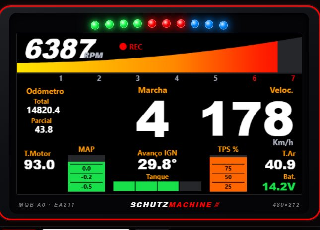
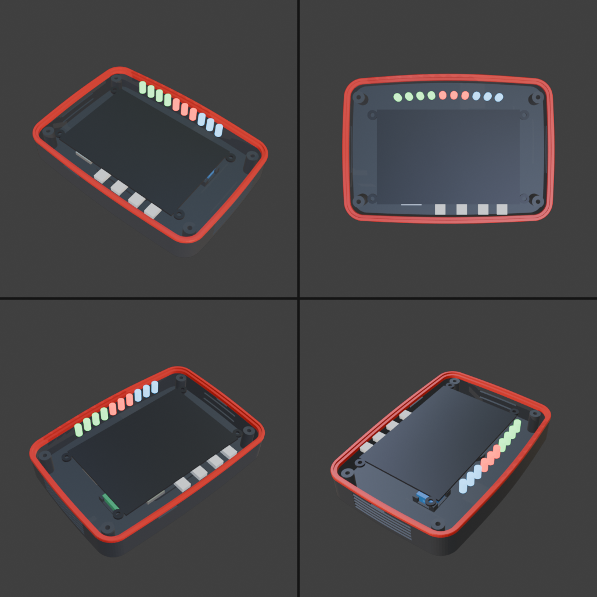
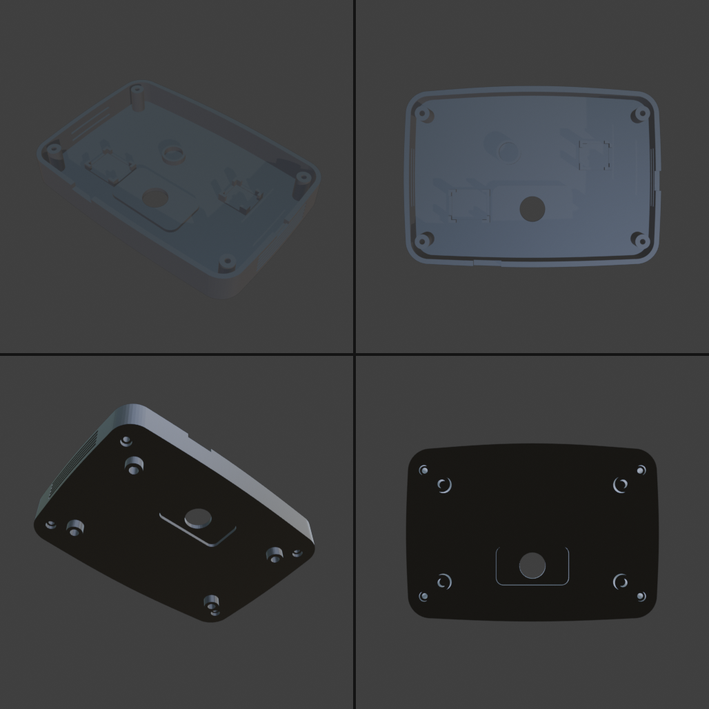
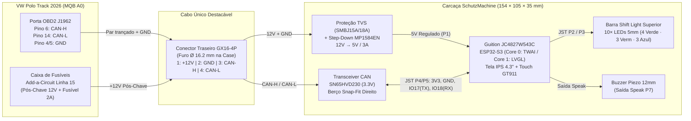
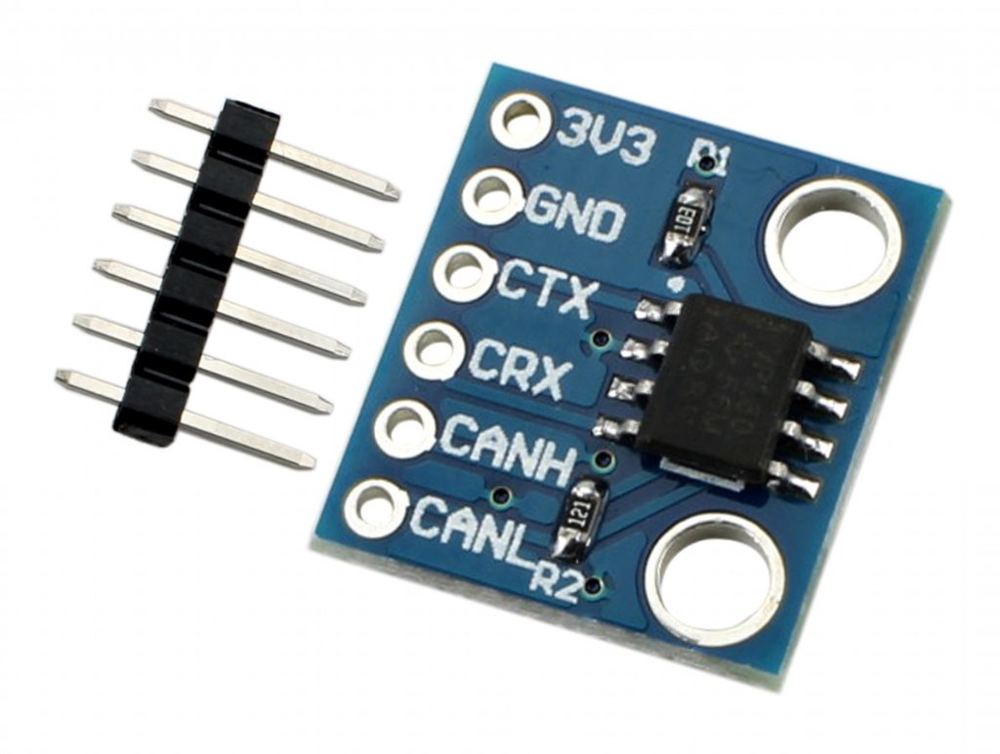
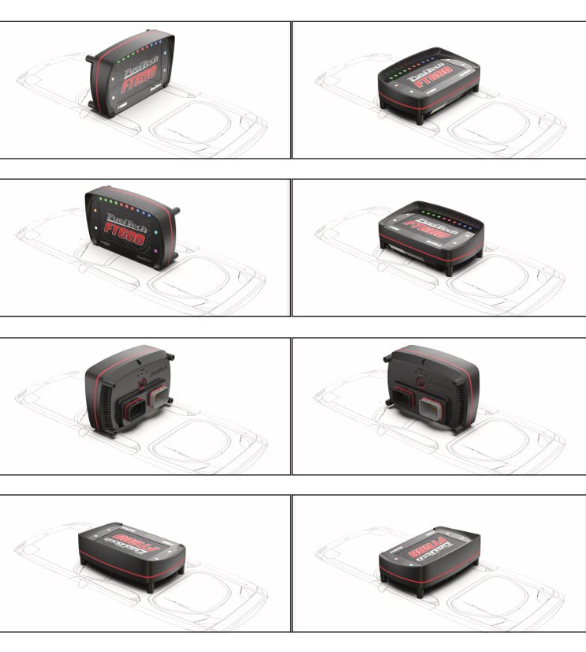
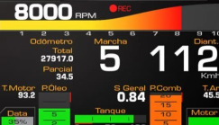
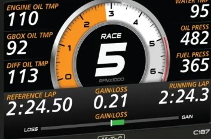

<div align="center">


### Painel Digital de Telemetria Automotiva Embarcada — Estilo FuelTech FT600 (4.3")
**Projetado sob medida para o Volkswagen Polo Track 2026 (Motor EA211 1.0 MPI · Câmbio Manual MQ200 · Plataforma MQB A0)**

<p>
  
  
  
  
  
</p>

<br/>



*Prévia real da tela de pilotagem (`480 × 272 px`) + 10 LEDs 5mm físicos no topo — abra o simulador interativo em [`frontend_preview/index.html`](./frontend_preview/index.html)*

</div>

---

## Visão Geral

O **SchutzMachine** é um painel digital automotivo dedicado (*stand-alone*) inspirado na ergonomia e estética da **FuelTech FT450 / FT600**, construído com hardware aberto de alta performance (**ESP32-S3** + tela capacitiva **IPS 4.3"** + **Shift Light físico de 10 LEDs 5mm**) e conectado diretamente ao barramento **CAN** do veículo via porta **OBD2** — eliminando a latência, travamentos e instabilidade de adaptadores ELM327 Bluetooth.

Toda a eletrônica (display, ESP32-S3, transceiver CAN, regulador Step-Down 12V→5V, barra de Shift Light e buzzer) fica **embutida dentro de uma carcaça paramétrica em 3 peças imprimível sem pintura**, ligada ao carro por um **único cabo destacável** com conector de painel **GX16-4P**.

### Premissas & Veículo Alvo

| Parâmetro | Especificação |
| :--- | :--- |
| **Veículo Alvo** | **Volkswagen Polo Track 2026** — Motor EA211 1.0 MPI (3 cil.), Câmbio Manual MQ200 (5 marchas), Plataforma MQB A0 |
| **Referência Mecânica (EA211)** | Torque máx.: `10,3 kgfm` (E) @ 3.000 RPM / `9,6 kgfm` (G) @ 4.000 RPM · Potência máx.: `84 cv` (E) / `77 cv` (G) @ 6.450 RPM · Corte: `~6.800 RPM` · Pneus: `185/65 R15` |
| **Hardware Principal** | **Guition JC4827W543C** (ESP32-S3-WROOM-1 N4R8 · 8 MB Octal PSRAM · 4 MB Flash · IPS 4.3" 480×272 QSPI NV3041A · Touch GT911) |
| **Interface Veicular** | Barramento CAN (`500 kbps`, ISO 15765-4) via transceiver **SN65HVD230** (3,3 V) + conector OBD2 macho J1962 |
| **Chicote Único** | Conector circular de painel **GX16-4P** na traseira da carcaça (Pós-chave 12V + GND + CAN-H + CAN-L) |
| **Instalação** | **100% reversível**, sem corte de chicotes originais, preservando integralmente a garantia de fábrica |

---

## Galeria do Projeto 3D (Carenagem Estilo FuelTech FT600)

Modelada parametricamente em Python/Blender (`1 unidade = 1 mm`) no script [`gerar_case_ft600_polo.py`](./gerar_case_ft600_polo.py), com **logo vetorial `SchutzMachine` gravada em baixo-relevo** na frente (`0.6 mm`) e nas costas (`0.8 mm`) e **auditoria física de espaço interno** para 100% dos componentes e conectores.

<table>
  <tr>
    <td align="center" width="50%">
      <br/>
      <sub><b>Revisão Final (v3):</b> Logo <code>SchutzMachine</code> gravada em baixo-relevo na moldura frontal e na tampa traseira + 10 LEDs 5mm no topo</sub>
    </td>
    <td align="center" width="50%">
      <br/>
      <sub><b>Auditoria Interna:</b> PCB Guition 4.3", 4 plugues JST P2..P5, 10 LEDs 5mm, SN65HVD230 (azul), Step-Down MP1584EN (verde) e Buzzer 12mm</sub>
    </td>
  </tr>
  <tr>
    <td align="center" width="50%">
      <br/>
      <sub><b>Vista Explodida:</b> As 3 peças da carenagem (sem pintura) + todos os módulos internos alinhados</sub>
    </td>
    <td align="center" width="50%">
      <br/>
      <sub><b>Bandeja de Impressão 3D:</b> 3 arquivos <code>.STL</code> individuais já na orientação ideal (<code>Z_min = 0</code> na mesa)</sub>
    </td>
  </tr>
  <tr>
    <td align="center" width="50%">
      <br/>
      <sub><b>Etapa 1 (<code>01_tampa_frontal.stl</code>):</b> 10 sedes escalonadas (Ø 6.4 → Ø 5.25 mm) para LEDs 5mm comuns + 8 torres para insertos M3</sub>
    </td>
    <td align="center" width="50%">
      <br/>
      <sub><b>Etapa 3 (<code>03_tampa_traseira.stl</code>):</b> Berços snap-fit dedicados para SN65HVD230, MP1584EN, Buzzer 12mm e furo Ø 16.2 mm p/ GX16-4P</sub>
    </td>
  </tr>
</table>

---

## Arquitetura do Sistema



---

## Lista de Materiais (BOM) e Módulos Reais

Todos os berços, sedes e folgas da carcaça 3D foram projetados a partir das **dimensões físicas reais** de cada componente:

<table>
  <tr>
    <td align="center" width="50%">
      <br/>
      <sub><b>Transceiver CAN SN65HVD230 (3.3 V)</b> — <code>16.5 × 14.5 × 6.0 mm</code><br/>Berço snap-fit dedicado no lado direito traseiro (longe da antena Wi-Fi)</sub>
    </td>
    <td align="center" width="50%">
      <br/>
      <sub><b>Step-Down D-SUN MP1584EN (12V → 5V)</b> — <code>22.0 × 17.0 × 4.5 mm</code><br/>Berço snap-fit dedicado no lado esquerdo inferior (perto da ventilação)</sub>
    </td>
  </tr>
</table>

| Componente | Modelo / Especificação | Dimensões Reais (mm) | Documentação / Referência |
| :--- | :--- | :---: | :--- |
| **Placa + Tela 4.3"** | Guition **JC4827W543C** (ESP32-S3 N4R8, NV3041A, GT911) | `120.0 × 70.2 × 4.7`<br/>*(Área útil: `95.04 × 53.86`)* | [Fabricante (.ZIP)](https://pan.jczn1688.com/directlink/1/HMI%20display/JC4827W543.zip) · [GitHub Pinout/LVGL](https://github.com/profi-max/JC4827W543_4.3inch_ESP32S3_board) · [Guia PDF](https://github.com/OldNKrusty/JC4827W543-ESP32S3-Guide) · [3D STEP](https://grabcad.com/library/jc4827w543-cyd-4-3-inch-272x480-1) |
| **Transceiver CAN** | Módulo azul 6 pinos **CJMCU-230 / SN65HVD230** (3,3 V) | `16.5 × 14.5 × 6.0` | [Datasheet TI (PDF)](https://www.ti.com/lit/ds/symlink/sn65hvd230.pdf) · [Waveshare Wiki](https://www.waveshare.com/wiki/SN65HVD230_CAN_Board) |
| **Regulador Step-Down** | Módulo verde **D-SUN MP1584EN** (Ajustar para `5.0 V` antes de ligar!) | `22.0 × 17.0 × 4.5` | [Datasheet MPS (PDF)](https://www.monolithicpower.com/en/documentview/productdocument/index/version/2/document_type/Datasheet/lang/en/sku/MP1584EN-LF-Z/) |
| **Shift Light (Topo)** | **10× LEDs difusos 5mm** comuns de kit (`4 Verde + 3 Vermelho + 3 Azul`) + resistores | Lente `Ø 5.0` · Base `Ø 5.9` · Alt. `8.6` | Montagem direta nas 10 sedes escalonadas no arco superior |
| **Conector Traseiro** | Conector circular de painel **GX16-4P** (Macho painel + Fêmea cabo) | Rosca `Ø 16.0` *(Furo `Ø 16.2`)* | Entrada única destacável: `+12V` + `GND` + `CAN-H` + `CAN-L` |
| **Alerta Sonoro** | Buzzer Piezo `12 mm` (opcional, saída `Speak` P7) | `Ø 12.0 × 7.5` | Anel snap-fit dedicado na tampa traseira |
| **Proteção Elétrica** | Diodo TVS automotivo **SMBJ15A / SMBJ18A** + Fusível `2 A` + *Add-a-Circuit* | — | Protege o MP1584EN (máx. 28 V) contra picos *load dump* do alternador |
| **Fixação Mecânica** | 8× Insertos metálicos **M3** (`Ø 4.2 mm`) + 4× Insertos **M4** (`Ø 5.2 mm`) + parafusos | — | 4× M3 para o PCB + 4× M3 para fechamento da carcaça + 4× M4 nos pés traseiros |

> [!WARNING]
> **Atenção Térmica (Sol no Painel):** Segundo a Tabela 1-1 do [Datasheet ESP32-S3-WROOM-1](https://documentation.espressif.com/esp32-s3-wroom-1_wroom-1u_datasheet_en.pdf), a variante **N4R8** (8 MB Octal PSRAM) tem faixa nominal de `-40 °C a +65 °C`. **Ativar o `PSRAM ECC` no firmware eleva o limite operacional para `+85 °C`** (sacrificando apenas 1/16 da PSRAM) — essencial para painel automotivo sob o sol, em conjunto com os rasgos laterais de ventilação da case.

> [!CAUTION]
> **Proteção contra *Load Dump* e Ajuste do MP1584EN:**
> 1. **Sempre ajuste o trimpot do MP1584EN para `5.00 V` na bancada com multímetro** antes de conectá-lo à placa Guition.
> 2. O barramento 12 V automotivo pode sofrer picos transitórios acima de 28 V (*load dump*). Instale um **diodo TVS (ex.: SMBJ18A)** na entrada do MP1584EN ou utilize um conversor automotivo encapsulado (8–36 V).

---

## Ligações Elétricas e Pinagem

> [!IMPORTANT]
> **Particularidade Crítica do CAN Gateway (VW MQB A0):** O módulo CAN Gateway (`0x19`) bloqueia dados do motor na porta OBD2 em modo passivo (*passive sniffing*). O firmware opera obrigatoriamente com **polling ativo** (requisições em `0x7DF` ou `0x7E0` com resposta em `0x7E8`) a **500 kbps** (ISO 15765-4). A proteção SFD/SFD2 não impede leitura de telemetria OBD2.

### 1. Chicote Externo: OBD2 (J1962) + Pós-Chave → Conector Traseiro `GX16-4P`

| Pino `GX16-4P` | Origem no Veículo | Destino Interno na Case | Observação Física |
| :---: | :--- | :--- | :--- |
| **Pino 1** | Caixa de Fusíveis — Linha 15 (**Pós-Chave 12 V**, *Add-a-Circuit* 2 A) | Entrada `IN+` do Step-Down `MP1584EN` (+ TVS) | **Não usar Pino 16 do OBD2** (Linha 30 permanente drena a bateria) |
| **Pino 2** | OBD2 **Pino 4 ou 5** (`GND` Chassi / Sinal) | `GND` comum (`MP1584EN` + `SN65HVD230` + PCB) | Referência elétrica única entre carro e eletrônica |
| **Pino 3** | OBD2 **Pino 6** (`CAN-H`) | `CANH` do `SN65HVD230` | Usar **par trançado** (Cat5e/Cat6) com o Pino 4 |
| **Pino 4** | OBD2 **Pino 14** (`CAN-L`) | `CANL` do `SN65HVD230` | Usar **par trançado** (Cat5e/Cat6) com o Pino 3 |

*(Nota: O módulo azul SN65HVD230 traz um resistor SMD `121` = 120 Ω em `R2`. Caso o barramento do carro apresente erro de comunicação, remova `R2`, pois o barramento OBD2 já possui terminação interna).*

### 2. Conexão Interna: `SN65HVD230` → Placa `Guition JC4827W543C` (JST MX 1.25 mm)

| Conector `P4` / `P5` (JC4827W543C) | Pino `SN65HVD230` | Função no Firmware (ESP-IDF / TWAI) |
| :---: | :---: | :--- |
| `3.3V` | `3V3` | Alimentação exclusiva em **3,3 V** (**nunca aplicar 5 V**) |
| `GND` | `GND` | Terra comum |
| `IO17` | `CTX` (TX) | `TWAI_TX_GPIO` (mapeado via GPIO Matrix) |
| `IO18` | `CRX` (RX) | `TWAI_RX_GPIO` (mapeado via GPIO Matrix) |

*Expansões livres na placa:* `P2` (`IO46`, `IO9`, `IO14`, `IO5`) e `P3` (`IO6`, `IO7`, `IO15`, `IO16`) disponíveis para acionamento da barra de Shift Light (via shift register 74HC595 / transistores para os 10 LEDs 5mm); saída `Speak` (`P7`) para o buzzer piezo 12 mm.

---

## Mapeamento de Telemetria OBD2 (Mode `0x01`)

As consultas são escalonadas em **filas de prioridade** no Core 0 do ESP32-S3 para garantir conta-giros fluido de **30 a 50 Hz**:

| Variável / Sensor | PID OBD2 | Prioridade / Taxa | Exibição na Tela SchutzMachine (`480 × 272`) |
| :--- | :---: | :---: | :--- |
| **Rotação do Motor (RPM)** | `0x0C` | **Alta** (20–40 Hz) | Curva crescente superior `0–7.000 RPM` + peak-hold + numérico gigante (`0,25 RPM`) |
| **Velocidade do Veículo** | `0x0D` | **Alta** (20–40 Hz) | Velocímetro digital real via ABS gigante à direita (`KM/H`) |
| **Posição da Borboleta / Pedal** | `0x11` / `0x49` | **Alta** (10–20 Hz) | Barra vertical graduada laranja (`TPS %`) |
| **Carga do Motor / Avanço Ignição** | `0x04` / `0x0E` | **Média** (5–10 Hz) | Blocos `CARGA %` (base esq.) e `AVANÇO IGN` (base centro) |
| **Pressão no Coletor (MAP / Vácuo)** | `0x0B` | **Média** (5 Hz) | Barra vertical graduada verde (`MAP bar`) |
| **Temp. Líquido de Arrefecimento** | `0x05` | **Baixa** (1 Hz) | `T.ÁGUA` real da ECU sem filtro de 90 °C (alerta visual `> 104 °C`) |
| **Temp. Ar de Admissão (IAT)** | `0x0F` | **Baixa** (1 Hz) | Bloco `T.AR IAT` |
| **Tensão da Bateria / Módulo** | `0x42` | **Baixa** (1 Hz) | Bloco `BATERIA` (alerta visual `< 12.2 V`) |
| **Nível de Combustível** | `0x2F` | **Baixa** (0,2 Hz) | Barra horizontal segmentada `TANQUE %` (alerta de reserva `<= 15%`) |

---

## Software, Marchas e Shift Light

- **Stack:** C++ (PlatformIO / ESP-IDF ou Arduino) + **LVGL 9** (framebuffers duplos na PSRAM de 8 MB + widgets nativos enxutos para a Flash de 4 MB).
- **Arquitetura Dual-Core (FreeRTOS):**
  - **Core 0:** Driver nativo **TWAI (CAN)** + escalonador de polling OBD2 + cálculo de marcha e controle dos 10 LEDs 5mm.
  - **Core 1:** Renderização gráfica **LVGL 9** (QSPI NV3041A) + leitura do touch capacitivo **GT911**.
- **Prévia Interativa da Tela:** Abra [`frontend_preview/index.html`](./frontend_preview/index.html) no navegador para testar a arrancada simulada `0–100 km/h`, os alertas de temperatura/bateria/reserva e a alternância `SPORT` / `ECO` em tempo real.

### Detecção e Calibração de Marchas (Câmbio Manual MQ200)

$$R = \frac{\text{RPM}}{\text{Velocidade (km/h)}}$$

- **Calibração via Touch (NVS):** No menu *"Calibrar Marchas"*, o motorista mantém velocidade constante em cada marcha (1ª a 5ª) e toca na tela para gravar a razão $R_n$ na memória não-volátil (**NVS**).
- **Inferência em Tempo Real:** O $R$ instantâneo é comparado às faixas gravadas com tolerância de **±8%**. Com embreagem acionada ou veículo parado/ponto morto, exibe `N`.

### Perfis de Shift Light (10× LEDs 5mm no Topo: 4 Verde · 3 Vermelho · 3 Azul)

| Perfil | Faixa de RPM | Comportamento Visual & Sonoro |
| :--- | :--- | :--- |
| **Modo Sport** | `4.500 – 5.499 RPM` | Acendimento progressivo dos **4 LEDs Verdes** |
| **Modo Sport** | `5.500 – 6.099 RPM` | Acendimento progressivo dos **3 LEDs Vermelhos** |
| **Modo Sport** | `6.100 – 6.449 RPM` | Acendimento dos **3 LEDs Azuis** |
| **Modo Sport (Peak)** | `>= 6.450 RPM` | **Flash total** nos 10 LEDs + alerta na tela + bip opcional no buzzer (pico de potência antes do corte de ~6.800 RPM) |
| **Modo Eco / Cidade** | `2.200 – 3.000 RPM` | Indicação progressiva nos 4 LEDs verdes orientando troca na faixa de torque máximo e menor consumo |

---

## Engenharia da Case 3D e Guia de Impressão

- **Dimensões Externas:** `154.0 mm (L) × 105.0 mm (A) × 35.0 mm (P)` *(+ 6 mm dos 4 pés traseiros M4)*
- **Topologia Validada:** Todas as 3 peças exportadas com **`0 boundary edges`** (malhas fechadas prontas para fatiamento).

### Auditoria Mecânica de Espaço Interno

| Verificação Interna | Valor Medido no 3D | Status |
| :--- | :---: | :---: |
| Distância vertical (Y) entre base dos LEDs 5mm e topo do PCB | **`5.20 mm`** | Livre de colisão |
| Canal vertical (Y) abaixo do PCB para plugues JST `P2..P5` + curva de fios | **`8.90 – 10.90 mm`** | Aprovado (mín. 8.0 mm) |
| Canal horizontal (X) à direita do corpo do PCB para `P1` e `USB-C` | **`21.10 mm`** | Aprovado |
| Profundidade livre total (Z) atrás do PCB | **`18.40 mm`** | Aprovado |
| Folga axial (Z) entre topo do `SN65HVD230` e costas do PCB | **`11.40 mm`** | Aprovado |
| Folga axial (Z) entre topo do `MP1584EN` e costas do PCB | **`12.90 mm`** | Aprovado |
| Folga axial (Z) entre terminais internos do `GX16-4P` e costas do PCB | **`7.20 mm`** | Aprovado |

### Impressão 3D em 3 Etapas Separadas (Sem Pintura)

Todos os arquivos em [`impressao_3d/`](./impressao_3d/) já estão exportados na **orientação ideal de impressão (`Z_min = 0.0` na mesa)**:

| Etapa | Arquivo `.STL` | Cor / Material | Orientação na Mesa | Parâmetros Recomendados |
| :---: | :--- | :---: | :--- | :--- |
| **1** | [`01_tampa_frontal.stl`](./impressao_3d/01_tampa_frontal.stl) | **Preto** — PETG ou ABS *(nunca PLA)* | Face frontal apoiada na mesa (`180°` em X); torres M3 e sedes LED p/ cima | Bico `0.4 mm` · Camada `0.20 mm` · 4 perímetros · Infill `25%` Gyroid |
| **2** | [`02_anel_vermelho.stl`](./impressao_3d/02_anel_vermelho.stl) | **Vermelho** — PETG ou ABS | Plano na mesa (`Z = 0`) · Sem suportes | Bico `0.4 mm` · Camada `0.16–0.20 mm` · 100% sólido nos perímetros |
| **3** | [`03_tampa_traseira.stl`](./impressao_3d/03_tampa_traseira.stl) | **Preto** — PETG ou ABS *(nunca PLA)* | Costas/pés para baixo; cavidade interna e berços snap-fit para cima | Bico `0.4 mm` · Camada `0.20 mm` · 4 perímetros · Suporte apenas sob os 4 pés M4 |

---

<details>
<summary><b>Referências Visuais de Inspiração (FuelTech FT600 / FT450 & MoTeC C187)</b></summary>
<br/>
<table>
  <tr>
    <td align="center" width="33%"><br/><sub>Referência de Carenagem FT600</sub></td>
    <td align="center" width="33%"><br/><sub>Referência de UI FuelTech FT600</sub></td>
    <td align="center" width="33%"><br/><sub>Referência Motorsport MoTeC C187</sub></td>
  </tr>
</table>
</details>

---

## Estrutura do Repositório

```text
schutzmachine/
├── README.md                                  # Documentação visual e técnica completa
├── .gitignore                                 # Ignora backups do Blender e pasta externa ref/
├── gerar_case_ft600_polo.py                   # Script paramétrico Blender (bpy) — 1 unid. = 1 mm
├── case_ft600_polo.blend                      # Montagem 3D completa com todos os componentes internos
├── SchutzMachine_color.svg                    # Logo oficial colorida (vetorial)
├── SchutzMachine_monocromatica.svg            # Logo monocromática usada na gravação 3D
├── frontend_preview/
│   ├── index.html                             # Simulador interativo da tela 480×272 + 10 LEDs 5mm
│   └── SchutzMachine_color.svg                # Logo vetorial usada no simulador
├── impressao_3d/
│   ├── 01_tampa_frontal.stl                   # Etapa 1 — Tampa Frontal (orientada p/ mesa)
│   ├── 02_anel_vermelho.stl                   # Etapa 2 — Friso Vermelho FT600 (orientado p/ mesa)
│   ├── 03_tampa_traseira.stl                  # Etapa 3 — Tampa Traseira com berços (orientada p/ mesa)
│   └── bandeja_3_etapas_impressao.blend       # Cena Blender com as 3 etapas lado a lado na mesa
└── docs/
    └── images/                                # Todos os renders 3D, previews da UI, fotos de HW e referências
```

---

## Roadmap de Execução

- [x] **Fase 0 — Engenharia Mecânica & Case 3D:** Modelagem paramétrica estilo FT600, auditoria física de espaço interno (PCB + 10× LEDs 5mm + SN65HVD230 + MP1584EN + Buzzer + GX16-4P), gravação da logo vetorial `SchutzMachine` e exportação dos 3 STLs individuais.
- [x] **Fase 0.5 — Protótipo Visual da Tela (`480 × 272`):** Simulador interativo estilo FuelTech FT600 com todos os sensores reais do EA211 1.0 MPI e barra física de 10 LEDs 5mm.
- [ ] **Fase 1 — Bancada & Display:** Validar placa Guition JC4827W543C, driver QSPI (NV3041A), touch GT911, brilho PWM e habilitar `PSRAM ECC` (+85 °C).
- [ ] **Fase 2 — Chicote & Comunicação CAN:** Montar chicote único J1962 + pós-chave → GX16-4P → SN65HVD230 (`IO17`/`IO18`) e validar polling ativo (`0x7DF`/`0x7E0` → `0x7E8`) a 500 kbps no Polo Track.
- [ ] **Fase 3 — Interface LVGL 9:** Portar a tela aprovada (`frontend_preview/index.html`) para C++ / LVGL 9 no ESP32-S3.
- [ ] **Fase 4 — Calibração de Marchas & Shift Light:** Persistência em NVS, perfis Sport/Eco nos 10 LEDs 5mm superiores, modo noturno e alerta sonoro.
- [ ] **Fase 5 — Impressão 3D & Instalação Final:** Impressão das 3 etapas em PETG/ABS, insertos M3/M4, montagem final e instalação reversível no painel.
